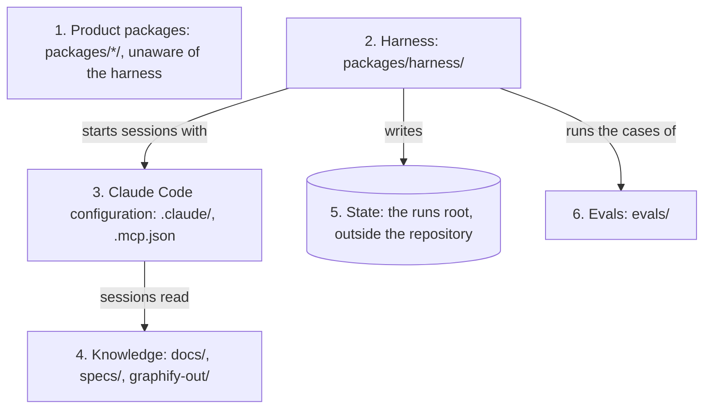
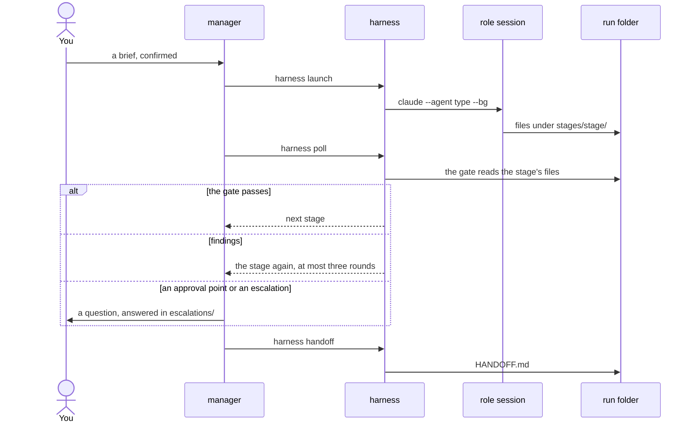
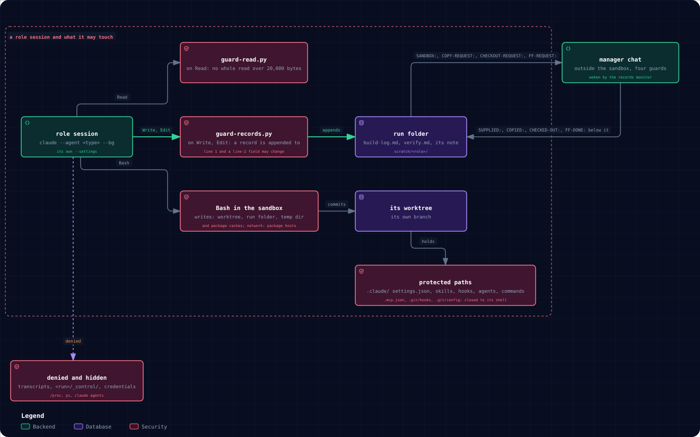
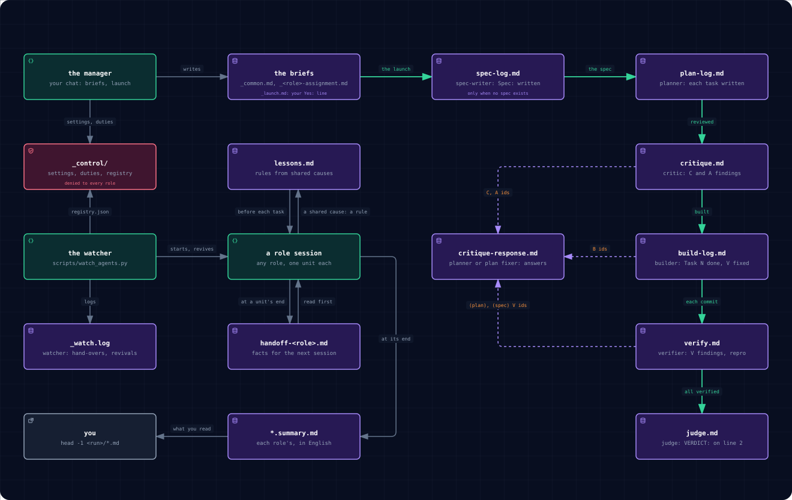

# Architecture

## Layers (dependencies point downward)
1. Product packages — `packages/<pkg>/` (uv workspace members). They know nothing about the harness.
2. Harness — `packages/harness/`: launches, polls, resumes and gates role sessions. It knows Claude Code's CLI, not
   the product.
3. Claude Code configuration — `.claude/` (settings, role types, skills, hooks, rules) and `.mcp.json`.
4. Knowledge — `docs/`, `specs/`, `graphify-out/`. Versioned in the repository; nothing lives only in chats.
5. State — `<runs root>/<run-id>/`, outside the repository: background sessions cannot write into the main checkout,
   and a write outside the working directory is not subject to worktree isolation. Generated, never committed; the
   only memory a run has.
6. Evals — `evals/`: tasks, graders, fixtures, baselines. Results are generated.

The diagram draws each layer with the relations the list states: the harness starts sessions from the Claude Code
configuration, writes the state and runs the eval cases (`uv run harness eval`); sessions read the knowledge; the
product packages stand apart.

## Where everything lives

| Place | What is there | Why there |
| --- | --- | --- |
| `.claude/agents/` | 21 role types: manager, planner, plan-fixer, critic, writer, verifier, test-verifier, judge, reader, quarantine-reader, researcher, analyst, synthesizer, classifier, comparator, validator, advisor, librarian, spec-writer, story-writer, translator | Claude Code loads them; `docs/roles/need-to-know.yaml` says what each may read; reviewers work blind, on copies |
| `docs/roles/` | a contract per type in `types/`; 10 documents, among them `MANAGER.md` and `HUMAN.md` (yours); the stage tables `stages.yaml`, `pipelines/`; `EXTENSIONS.md` and `extensions.yaml`: what the flow uses that this repository did not write | the harness runs the tables, `harness validate` checks them |
| `.claude/skills/` | 27 project skills, among them the pipeline skill `running-specagent-pipelines` (briefs, waiters, the watcher, the manager's scripts preflight, score_run, usage_report, collect_run, monitor_records), commit-style, doc-gardening and 11 from ECC | Claude Code loads project skills from here; each ECC skill keeps its MIT `LICENSE` and `SHA256SUMS` |
| `.claude/ecc/` | the text of 70 ECC agent definitions (`agents/`); [`README.md`](.claude/ecc/README.md), the catalogue of every ECC text, skill and rule, read by the manager before a brief for a role with a domain | material for briefs, not loaded: ECC is taken by selection, never its mechanism ([decision](wiki/decisions/ecc-content-is-pinned-never-its-mechanism.md)); its 11 rules for Python, C++ and TypeScript (`.claude/rules/ecc/`) each load only for a file of their language (`paths:`) |
| `plugins/` | `code-intel` (language servers) | the template's own plugin; `marketplace.json` also declares `obsidian-vault` |
| `obsidian-vault` | claude-obsidian 3.0.1, 15 skills (wiki-ingest, wiki-lint, wiki-query, …) | installed at project scope from git by `ops/bootstrap.py`, pinned in `docs/roles/extensions.yaml` |
| `specs/` | `constitution.md`, `001-chat-depth/` to `004-consolidation/` | the spec-writer's specs: software-factory approves the spec before the plan and the code |
| `wiki/`, `context/`, `docs/decisions/` | 46 decision pages (44 ingested, with sources and claims), `hot.md`, `index.md`; raw material; the ADRs | the checkout is a claude-obsidian vault |
| `packages/harness/` | the CLI (`uv run harness --help`): validate, docs-check, wiki-lint, extensions, gate, loop, eval | stages, gates and loops as code |
| `ops/`, `templates/vault/` | `new-project.py`, `bootstrap.py`, `machine-setup.py`, `new-vault.py`, `contribute.py`, `obsidian-ingest.py`; a vault skeleton | setup and the knowledge flow |
| `docs/template/` | `PROJECTS.md`, `MIGRATIONS.md`, `VERSION`, `variables.yaml` | what a project gets ([how](docs/template/PROJECTS.md)); its `README.md` is a stub, the template's kept here |
| `evals/` | 19 regression cases (14 graded by code, with no model and no key; 5 model runs) and 1 capability case | checks for the roles |

`clean_jobs_tmp.py` (pipeline skill) removes finished background jobs' `tmp` folders, only with `--apply`; a finished
run's worktrees and scratch wait for TD-010 (`docs/exec-plans/tech-debt-tracker.md`).

## One run, end to end
manager (interactive) → `harness launch` → role session (`claude --agent <type> --bg`) → files under
`<runs root>/<run-id>/stages/<stage>/` → `harness poll` → gate → next stage or escalation → `HANDOFF.md`
(rendered by `harness handoff`, [RUNS.md](docs/roles/RUNS.md)). The sequence below is one stage of it; findings send
the stage back, at most three rounds per counter ([Pipelines](#pipelines)).

The pipeline skill runs the roles as chat sessions under a manager chat with a loop of its own: waiters, the watcher
and record files in place of `harness launch`, `poll` and `handoff`
([decision](wiki/decisions/pipelines-run-as-specagent-sessions-from-a-template-skill.md));
[How it works, step by step](docs/how-it-works.md) follows one such run file by file.

## A role session's sandbox
Every role session but one that edits a checkout served by a local dev server or containers runs its shell commands
in the sandbox (bubblewrap on Linux), with no unsandboxed retry: Bash writes only in its worktree, where it commits on
its branch, the run folder, the temp dir, the package caches and the main repository's `.git`, and reaches only the
package hosts; the worktree's eight protected paths are closed to its shell, open to Write and Edit, and the
transcripts, the run's `_control/`, `docs/handoff/` and `/proc` are denied. Two guards run before a Read, Write or Edit
call: one refuses a whole read of a file over 20,000 bytes, the other keeps a record in the run folder appended to. A
refused step, a copy into the protected paths, a checkout or a fast-forward is one line in its record (`SANDBOX:`,
`COPY-REQUEST:`, `CHECKOUT-REQUEST:`, `FF-REQUEST:`); the records monitor wakes the manager, outside the sandbox with
four guards, which answers below it (`SUPPLIED:`, `COPIED:`, `CHECKED-OUT:`, `FF-DONE:` or `REFUSED:`) and never
weakens the sandbox ([the detail](docs/what-a-role-may-touch.md)).

## The record files of a run
The run folder, outside the repository, is the run's only state: plain files, line 1 of each record its STATUS line. The
manager writes the briefs and the launch table, and the settings and the duty list from the plan into `_control/`, which
no role may read. The spec-writer (only when no spec exists), planner, critic, builder, verifier and judge log to
`spec-log.md`, `plan-log.md`, `critique.md`, `build-log.md`, `verify.md` and `judge.md`; the critic's C and A ids, a
builder's B ids and the verifier's `(plan)` and `(spec)` V ids are answered in `critique-response.md`. A session writes
its hand-over note at a unit's end and the fresh one reads it first; a cause shared by two findings becomes a rule in
`lessons.md`, which planner and builders read before each task; the watcher starts and revives sessions, keeps their
registry in `_control/` and logs to `_watch.log`. You read `head -1 <run>/*.md` and the `*.summary.md` each role writes
([the files of a run](docs/files-of-a-run.md)).

Both pictures are drawn by the archify skill from `docs/assets/src/`.

## Pipelines
In a harness run, `harness run` makes `<runs root>/<run-id>/`; for each stage `harness assign` stores what you would
write into a subagent's prompt, `harness launch` starts the session and a gate checks the result by code; findings send
the work back, at most three rounds per counter ([ADR-0024](docs/decisions/0024-a-run-loops-until-its-reviewers-pass.md));
`harness integrate` gives one branch to merge. The eight stage tables are
`docs/roles/stages.yaml` and the files of `docs/roles/pipelines/`. `uv run harness map` draws each as a Mermaid
flowchart in `docs/generated/maps/<name>.md`, which GitHub and Obsidian render with no renderer
([decision](wiki/decisions/diagrams-are-mermaid-text.md)); `uv run harness docs-check` reports a map that no longer
matches its table.

| Pipeline | Stages (a human approves where marked) |
| --- | --- |
| default | read, plan, attack (a critic of the plan and its trial; approval), write, verify, judge (approval); attack sends work back to plan, verify and judge to write, three rounds each at most |
| fix | as default without read: the defects of an approved audit are its material |
| software-factory | research, story (approval), spec (approval), plan, write, accept and validate in parallel, judge (approval) |
| council | frame, advise (a session per perspective), review, verdict (approval) |
| research | frame, investigate (a session per question), refute, synthesize (approval) |
| intake | digest (untrusted text, read-only), classify, then the pipeline the label names |
| wiki-ingest | ingest, wikicheck |
| learning | analyze finished runs, challenge the proposals, judge (approval) |

## Where humans enter
- The manager session (the only chat a human talks to).
- Escalation files (`<runs root>/<run-id>/escalations/*.json`), answered in place.
- Approval points named in `docs/roles/stages.yaml` (`approval: human`).
- `claude attach <id>` for a session that is blocked on a permission prompt.
- `just manager` opens the harness's manager (without `just`:
  `d="$(uv run harness runs-root --plain)" && claude --agent manager --add-dir "$d"`): it writes a brief from
  `templates/project-brief.md`, asks you to confirm it, creates a run beside the checkout and launches the first stage
  (`docs/roles/HUMAN.md`; its side: `docs/roles/MANAGER.md`).
- `uv run harness watch --run <id>` waits until something needs the manager; `uv run harness poll --all-active` prints
  every active run's state and next action.
- `uv run harness integrate --run <id> --clean` builds `run/<run-id>` for you to merge and removes the run's checkouts;
  `uv run harness abort --run <id> --reason "<why>"` ends a run, saving uncommitted work first.

## Check it yourself
With no Claude: `uv run pytest -q` (launcher, access rules, gates, extension check);
`uv run harness validate`, `audit --ci`, `docs-check`, `wiki-lint`, `loop validate` (the repository agrees with
itself); `uv run harness eval --suite regression --baseline` (every case's graders accept its reference outcome);
`uv run harness cache-report <transcript.jsonl>` (hit ratio, misses and their likely cause). With Claude:
`uv run harness eval --suite regression` (a role type, launched as a stage is, does the case) and `just manager` with
a small brief (launch, poll, gates, approvals end to end).
