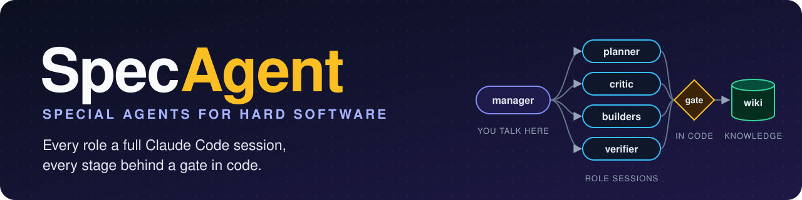
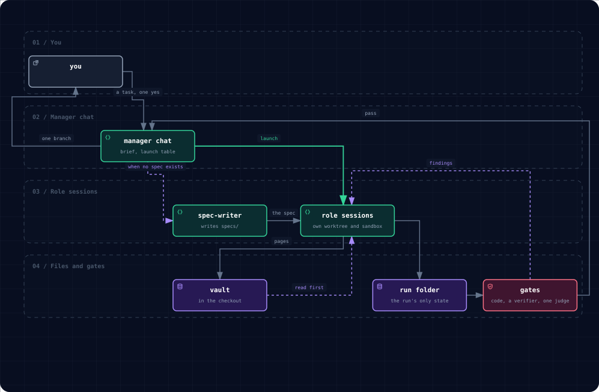
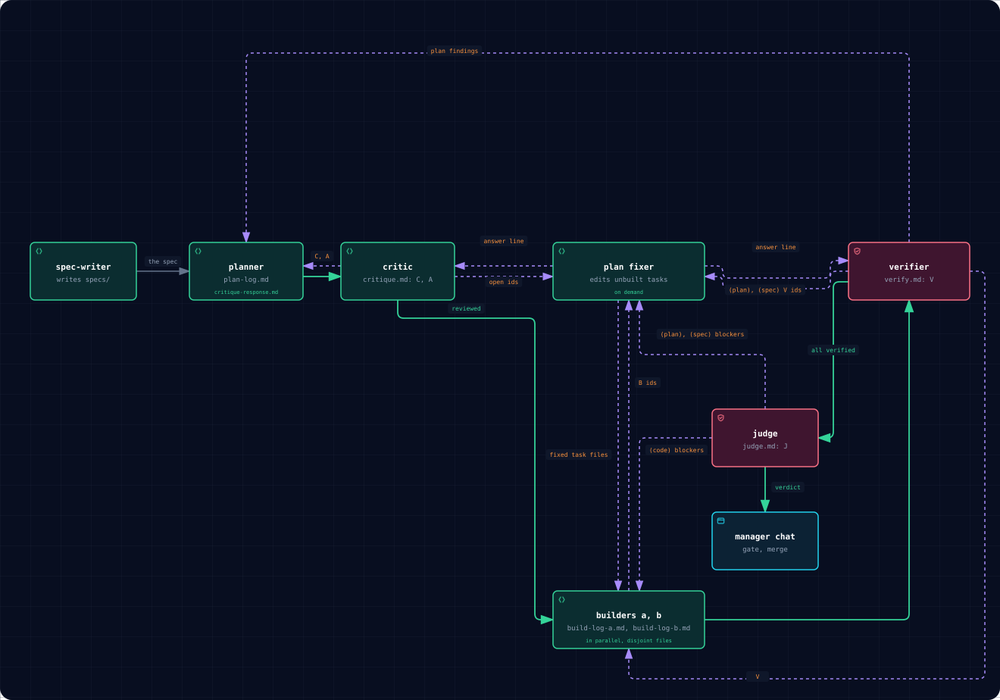
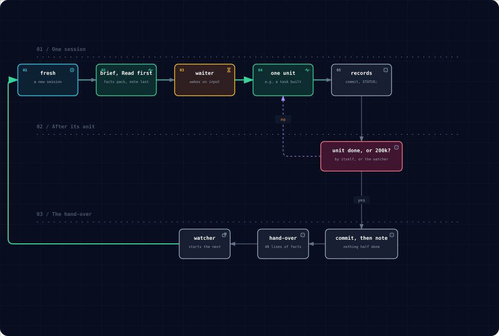
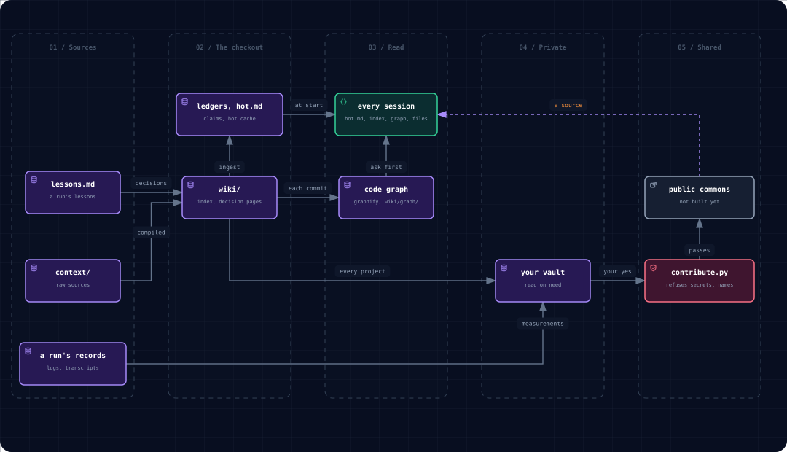
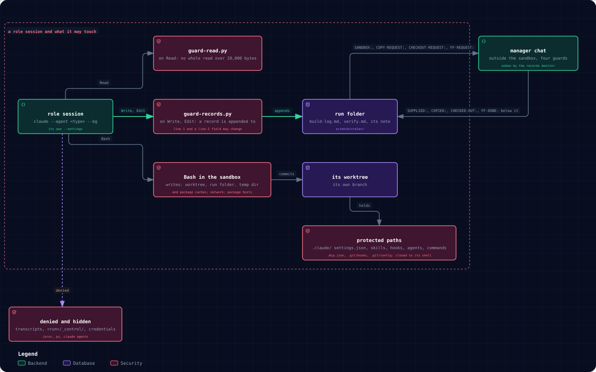
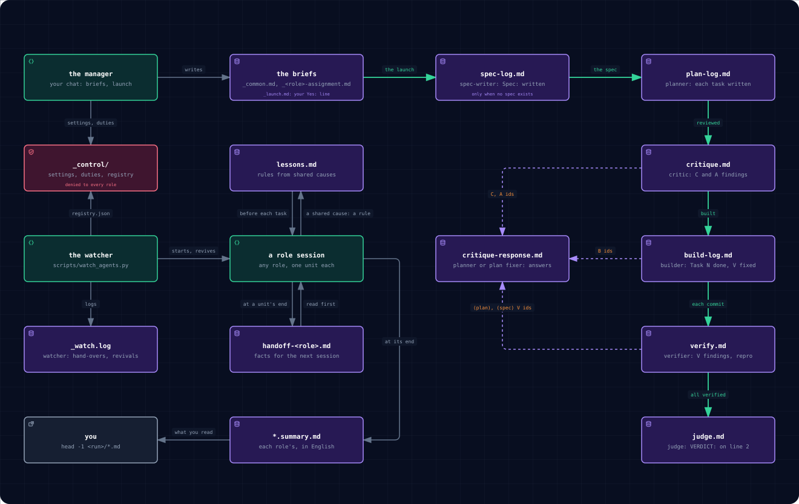

# SpecAgent

**SpecAgent: special agents for hard software, every role a full session.** An agentic system of its own design for
hard, multi-package projects, built by its own pipeline and measured run by run. You talk to one manager chat; it runs
every role as a full Claude Code session, never a subagent. A stage moves on only through a gate in code, a finding
counts only with its proof, and each session does one unit of work, then hands a note of facts to a fresh one. Every
user keeps a private vault, a page goes to a public commons only past checks in code (its repository is not built yet),
roles never learn a model or an author, and the sandbox sets itself up. One command makes a new project with all of it.

[Quick start](#quick-start) · [How it works](#how-it-works) · [Measurements](#where-it-saves-money) ·
[Against subagents](#against-subagents) · [Why it is built this way][why] · [Every document](docs/llms.txt)

## Why this is different

Running several Claude Code sessions side by side is not new: tmux scripts and CLI parallelizers hand each session a
task and collect the result. SpecAgent adds the whole loop around full sessions, each part with its evidence:

- **Every role is a full session, run by a manager chat,** with every demand a subagent would get for the same job
  ([ADR-0006][a6]) and its own context, worktree, sandbox and transcript. *The usual way:* subagents in one parent
  context, not resumable from another session ([ADR-0001][a1]).
- **The manager chat does what the sandbox refuses the roles:** it launches sessions on your yes and stops them, merges
  in any worktree, reads transcripts to measure every run and itself, and pushes the vault
  ([page](docs/roles/manager-chat.md)).
- **Every role starts from a brief:** `harness launch` answers `no_assignment` until the stage's assignment is written.
- **A stage moves on only through a gate in code,** three rounds per finding at most, then a rule decides
  ([skill]). *The usual way:* the model says it is done.
- **A finding counts only with its proof,** or it goes to "To check"; the eval case
  [`pipeline-critic-unproven-finding`](evals/regression/pipeline-critic-unproven-finding/task.yaml) fails a finding
  without proof.
- **One cycle to a product:** after your one yes at the launch, nothing inside the cycle waits for a human or a second
  cycle: findings are fixed inside the cycle by the role that owns them, and the planner fixes the plan for every
  later task ([skill], [why]). The pipeline-economy run of 2026-10-30 wrote its spec, built it, verified it and was
  merged (cb60f5b) in 3 h 12 min: 22 sessions, 1 finding fixed inside the run, 0 escaped to the gate; the
  obsidian-ingest run built 5 units and fixed its 5 findings inside the run (private measurement pages
  `2026-10-30-pipeline-economy`, `2026-10-30-obsidian-ingest`). Both ended with the full gate (1,874 and 1,840 tests
  passed); neither launched a judge.
- **Small contexts:** one unit per session, a hand-over at 200k; without the cap calls grew to 500-740k tokens, three
  times the cost of a fresh session (2026-10-15, [cost]). *The usual way:* one long context, re-read on every call.
- **The run lives in files a human reads:** a fresh session goes on from them, and the watcher revives a stopped one
  ([scripts]).
- **Every role is measured:** `usage_report.py` prints, per role, its sessions, calls, average context per call and
  cost ([scripts]).
- **A private vault per user; a page goes to a public commons only past checks in code** (`ops/contribute.py`; the
  commons repository itself is not built yet, [decision][kb]).
- **A new project starts with the rules already learned:** `ops/new-vault.py` seeds its vault with the template's
  global pages (30 at 1.8.0: 27 standing orders and 3 lessons, each lesson with its proof page; 4 measurement pages),
  carried from the owner's vault by `ops/sync-vault-globals.py`, which refuses a page with a model name, a private
  marker, a dangling link or more than 4,000 bytes (`ops/check_pages.py`; [migrations](docs/template/MIGRATIONS.md)).
- **A project updates by copying, not by a run:** from 1.8.0 a migration entry names every template-owned path that
  changed (a test fails when a commit leaves one out) and its steps are the copy and the checks, no hand-merge, no
  role. The 1.7.0 carry of a project was a run of 10 sessions, $30.60 and 1 h 41 min; the 1.8.0 carry is a copy.
- **The manager chat is held to rules in code and in its page:** a project's work runs through the pipeline skill, never
  through stage runs by default; the pre-flight refuses a critic with no planner to answer it; the manager does no
  role's work and writes to you only for a decision, a problem or a milestone
  ([page](docs/roles/manager-chat.md), `ops/tests/test_pipeline_choice.py`).
- **Roles are blind to models and authors:** their settings and sandbox deny the transcripts, the control files, the
  hand-over notes and `/proc` ([decision](wiki/decisions/roles-are-blind-to-models-and-authors.md)).
- **The sandbox sets itself up,** one password per machine at most
  ([ADR-0013](docs/decisions/0013-no-command-to-type-and-at-most-one-password.md)); a refused step is one `SANDBOX:`
  line, never a workaround ([decision][sandbox]).

[A subagent vs a SpecAgent role session][measured]: the scope, 15 properties side by side with their
evidence, what a role session can do and a subagent cannot, and the measured numbers.

## How it works

[How it works, step by step](docs/how-it-works.md): one run of the pipeline skill start to end, each step with the file
it writes.
The pictures below are drawn by the archify skill from `docs/assets/src/`,
[beside their Mermaid text](docs/assets/src/README.md).

[Where everything lives](ARCHITECTURE.md#where-everything-lives): each folder, what it holds and why it is there.
[The harness's eight pipelines](ARCHITECTURE.md#pipelines): the same loop from stage tables.

### The run loop

You talk to one **manager chat**. It writes the briefs and a facts pack, puts a **launch table** before you (each role,
its settings, its cost estimate) and takes your one yes ([decision](wiki/decisions/the-launch-table-and-one-yes.md));
then it starts the **role sessions** in the background, each in its own worktree and sandbox, in order: the
**spec-writer** only when no spec exists ([spec-writer]), the planner ⇄ the critic, a plan fixer on demand, the
builders, the verifier. Along the way the **watcher** replaces a session after its unit with a fresh one, through a
**hand-over note**, and a role asks the manager in its record for what its sandbox refuses. Last come one judge and
the gate that merges the run's one branch; the run's numbers go to your private vault, its decisions to the **vault**
in the checkout, then to yours. Roles write **records** in the **run folder**, the run's only state; **gates** (code, a
verifier, the judge) send findings back to their author but keep a judge's major or minor for you.



### The manager chat

The [manager chat](docs/roles/manager-chat.md), the pipeline skill's main session
([decision](wiki/decisions/the-manager-is-the-pipeline-skill-main-session.md)), runs without the sandbox behind four
guards: the permission rules, the auto-mode classifier, your launch rule, and no project code or tests run by itself. It
answers a role's refusal by supplying the path, host or material into the run folder, never by weakening a sandbox.
Before a run come the size rule (a pipeline only when one context cannot hold the work), the pre-flight, the launch
table and your one yes; during it, the records monitor, the surface (`surface.py`), whose figures its status answers
copy as printed, never computed, and orders a role acknowledges with `ACK <msg_id>`. It asks you only about agent
launches, destructive or irreversible actions, merges into `main` and spending, and decides the rest with its assumption
stated. It measures every run (`score_run.py`, [decision][score]) and itself (`measure_manager.py`) and appends each of
its mistakes, with its measured cost, to a lessons page in your vault that every main session reads in its first calls.

### The roles and their records

A long change runs as sessions of the pipeline skill, each in its own worktree
([decision](wiki/decisions/pipelines-run-as-specagent-sessions-from-a-template-skill.md)). When no spec exists, the
**spec-writer** writes it first, in `specs/`, as a one-page skeleton. The **planner** puts the flesh on it, writes each
task and answers its findings (`plan-log.md`,
`critique-response.md`); the **critic** makes one coverage round per task (`critique.md`: C and A findings). Two
**builders** take reviewed tasks on disjoint files, tests first, one commit per task (`build-log-a.md`,
`build-log-b.md`). The **verifier** reads each commit's diff and re-runs its checks (`verify.md`: V findings). A script
starts the **judge** once every task is verified (`judge.md`); it reads the diff and the reports and blocks only with
proof. Its verdict goes to the manager chat, which merges at the gate: a red gate goes back to the builder as a finding,
a green one is merged and pushed. Every finding has an id and goes back to its author (a judge's major or minor stays in
`judge.md` for you), a plan-caused one, whoever finds it, to the planner or a **plan fixer** launched on demand when
open ids pass a count or an age. The fixer fixes the plan for that task and every later one: it sends the fixed task
files to the builders and an answer line to the critic or the verifier, whichever raised the id, which re-checks and
closes it (`<id>: fixed` or `closed`). After three rounds a rule decides: the spec and recorded decisions win, else the
safer option.



### A session's life

A fresh session reads its brief, the hand-over rule, `lessons.md`'s "Read first", the facts pack its brief names
(`specs/003-pipeline-economy`, R4) and, last, its note, nothing else until a step asks; a waiter wakes it when its
input is there.
It does one unit (a task written, reviewed, built or verified) and leaves records: a commit, `Task N: done — <sha>`, a
`STATUS:` line, answers. It goes on until the unit is done, then hands over by itself; past 200k the watcher stops it
and resumes it once to hand over. Either way it commits its work, nothing half done, then writes a note of at most 40
lines of facts; the watcher starts a fresh session at the note. Only files pass between sessions
([hand-over rule][handoff]).



### The knowledge layer

The wiki is compiled from `context/`; a run's lessons become decision pages in `wiki/decisions/`, written with the work.
The checkout is a claude-obsidian vault ([decision][vault]): `ops/obsidian-ingest.py` ingests each page through the
plugin into its claim ledgers, and the plugin injects `wiki/hot.md` (at most 500 words) into every session. A session
then reads `wiki/index.md`, the page it needs, the code graph before any whole directory, then files
(`docs/architecture/knowledge.md`); git hooks refresh the graph from the repository at each commit (`just graph` in
full), layered in `wiki/graph/`, never committed
([decision](wiki/decisions/the-code-graph-is-generated-layered-and-refreshed-by-hooks.md)). A decision for every project
goes to your private vault, and so do each run's numbers ([how](docs/economy.md#the-measurements)); it is read on need,
never written by a role, and where they differ, a brief wins over it
([decision](wiki/decisions/the-owners-vault-is-read-on-need.md)). With your yes for one page, `ops/contribute.py`
refuses a private path, a secret, a name or a letter of the Unicode blocks it lists, naming the class, writing nothing;
a page that passes becomes a pull request (`candidate`), a rule once a second origin confirms it. What comes back is a
source, never an authority: your vault wins ([decision][kb]; not built yet: the commons repository and its review, a
critic session per page).



## Why it is good

The system keeps its own record. A commit that changes code adds or changes a page under `wiki/`, `docs/runbooks/` or
`docs/decisions/`, or its task says `docs: none — <reason>`; the write gate fails a branch that does neither, and a
changed decision is a new page ([decision](wiki/decisions/decisions-are-written-with-the-work.md)). Every claim in the
vault has its source: on 2026-10-30, 40 decision pages, 40 captured sources, 170 claims ([decision][vault]).
`score_run.py` measures every run the same way: findings per task by kind, sessions and hand-overs per role, cost per
task and per role ([decision][score]). The template checks itself: 1,840 tests passed at the merge gate of 2026-10-30
(`uv run pytest -q`), with `harness validate`, `docs-check`, `claude plugin validate ./plugins` and the vault's lint.
Every file is English, and `harness validate` refuses a letter of
the Unicode blocks it lists ([decision](wiki/decisions/the-template-is-english-only.md)).

## How it saves time

Each role starts as soon as its input is ready: a waiter script polls once a minute and wakes its session, so waiting
costs no tokens, and nothing starts on speculation: a builder waits for its task's coverage round ([scripts]). Nothing
waits for you: you say yes once, before the run; `AskUserQuestion` is denied, a dispute after round three is decided by
rule, a doubtful item is held and logged ([why]). Work runs side by side:
planner lanes, two builders on disjoint files, the verifier checking each commit while the next is built. The watcher
(`watch_agents.py`) hands a session over at a unit's end past 150k or at the cap and restarts a stopped one, without
loss and without a human ([scripts]). On 2026-10-30 the template's own build ran 8 tasks in 2 h 22 min, the ingest 5
units in 2 h 15 min (the table below).

## Where it saves money

A session does one unit and hands over, or at 200k: no cap costs twice as much, and a 300k cap cost 15-25% more per task
over 269 sessions ([cost], [hand-over rule][handoff]). A session reaches 81k tokens after ten calls, 84% of the growth
tool results, so a fresh session reads a note of facts, not the history ([cost]). The manager sets one
of three model classes per role in a settings file no role reads: for the spec, the class the owner ordered
([decision](wiki/decisions/the-spec-writers-model-is-a-dated-exception.md)); judgment for a role whose mistake is
expensive (the planner, critic, verifier, judge); mechanical for work that code or a verifier checks (the builder)
([skill]).

[Time and money](docs/economy.md): the cache, a session's start, reading on need, what quality costs, a third run,
with sources.

### Two measured runs of 2026-10-30

What a real run of this system costs and takes, from the measurement pages `2026-10-30-template-surface` and
`2026-10-30-obsidian-ingest` (in a private vault):

| Run | Roles | Units | Sessions | Findings, all fixed | Cost | Wall clock |
| --- | --- | --- | --- | --- | --- | --- |
| fold-task6: the template's own build | builder, verifier, the plan fixer on demand | 8 tasks | 15 | 14 V | $35.57 | 15:09-17:31Z |
| obsidian-ingest: 40 decision pages through the plugin | builder (mechanical class), verifier | 5 | 23 | 5 V | $43.01 | 18:44-20:59Z |

## How it keeps quality, and at what cost

A harness stage moves on only when its gate passes (the write gate: `packages/harness/src/harness/gates/write.py`).
A verifier in its own worktree checks out each built commit, reads its
diff against the task and re-runs the task's checks (`example/verifier-assignment.md` of the [skill]). A dispute gets
three rounds, then the rule above; a harness run stops for
you after 3 rounds per counter or 5 starts of `write` ([why]). One judge reads the diff and the reports
once, last; 19 regression cases check the roles ([evals],
[ADR-0028](docs/decisions/0028-pipeline-evals.md)). The cost is a second session per unit and the records on disk: the
verifier took $10.10 of the $35.57 and $21.98 of the $43.01 above (the same pages).

[Check it yourself](ARCHITECTURE.md#check-it-yourself), with and without Claude.

## Against subagents

A subagent (the Agent tool) is a call inside one session, in the parent's place and bill; a role session is a full
chat (`claude --agent <type> --bg`) with its own tools and permissions ([ADR-0001][a1]). Eleven properties side by side:

| Property | A subagent | A role session | Evidence |
| --- | --- | --- | --- |
| Context | a slice of the parent's window | its own window, one unit per session, a fresh session at the 200k cap | [hand-over rule][handoff] |
| Memory after the call | gone; its result is pasted into the parent | a transcript, a hand-over note and a record file | [hand-over](docs/how-it-works.md#7-a-session-hands-over) |
| Observability | internal to the parent's session | `build-log.md`, `verify.md`, `*.summary.md`, read while it works | [records](docs/files-of-a-run.md) |
| Resumability | not from another session after a crash or a limit | `claude --resume <id>`; the watcher revives a stopped session from its files | [ADR-0001][a1], [scripts] |
| Isolation | the parent's tree and permissions | its own worktree, sandbox and settings; requests answered by the manager | [decision][sandbox] |
| Verification | the parent trusts the output | a verifier in its own worktree, a repro per finding, 3 rounds then a rule, a judge once | [skill] |
| Feedback loop | its result ends at the parent; peers do not talk | every plan-caused finding goes back to the planner, who fixes that task and every later one | [skill] |
| Cycles to a product | its result is re-dispatched by the parent until it fits | one run, findings fixed inside it | [measured] |
| Cache | its context is built anew for each call | its cached prefix is read call after call: 98% cache read | [measured] |
| Parallelism | inside the parent's session | sessions side by side for hours, each in its own window: two builders, a critic, a plan fixer and a verifier at once; 103 sessions in one run | [measured] |
| Cost | lumped into the parent's bill | measured per role (`usage_report.py`) and per session (`score_run.py`) | [decision][score] |

SpecAgent is for hard work: many packages, many days, many roles. Outside that scope a subagent is the better tool: a
short lookup inside one turn, with nothing to record and nothing to resume, costs one call and no files.
[The full table][measured] has all 15 properties with their evidence. The price ([ADR-0001][a1]): roles
coordinate by files and polling, and the manager cannot steer a role mid-turn.



## Quick start

```bash
python3 ops/new-project.py <dir> repo_name=<name> org=<org> [vault_path=<path>] --container   # a project of your own
uv run harness doctor         # the machine, the vault and the commons: prints the fix for what is missing
uv run harness validate       # configuration, stage tables, access table, extensions
claude                        # a chat in the checkout: ask it for a pipeline run
```

`ops/new-project.py` copies the template, sets it up with `ops/bootstrap.py` (`just`, the git hooks,
the sandbox, the first code graph) and makes your vault when it is missing
(`docs/template/PROJECTS.md`); in a plain clone the first session runs `ops/bootstrap.py` in the background after the
trust dialog. A run never lives in the checkout: `runs/`, `experiments/` and
`docs/handoff/` sit beside it, your vault (`~/vault`) and the commons clone (`~/aftpro-commons`) outside;
`git clone https://github.com/ghvinashvili/specagent.git <dir>/template && python3 <dir>/template/ops/container.py`
makes this shape, and `--container` gives a project the same, its checkout in `<dir>/<name>/`.

The chat you open is the [manager chat](#the-manager-chat); `just manager` opens the harness's own manager instead:
[ARCHITECTURE.md](ARCHITECTURE.md#where-humans-enter) shows how it briefs, launches and asks you.

You need Claude Code at the version in `.claude/settings.json` (`minimumVersion`) or newer, `git` and `python3`; `uv`,
the workspace, the plugins and the language servers set themselves up, pinned and checked
([ADR-0009](docs/decisions/0009-a-checkout-sets-itself-up.md)). On Linux `ops/machine-setup.py` provides `bubblewrap`
and `socat` (in `~/.local/bin`) and user namespaces for bubblewrap, as this user where the kernel allows, else with one
password; native Windows has no sandbox, so the repository runs in WSL2. `just` and `gh` are optional.

**Platforms:** Linux, fully exercised (every measured run in this README); Windows and macOS documented, untested
(`docs/runbooks/server-windows.md`, `ops/machine-setup.py`). The sandbox is Linux's bubblewrap; on Windows and macOS it
is a different mechanism, which the template does not set up today.

## What every role session is told

The harness's manager briefs a role session as it would a subagent: it writes the stage's assignment
(`templates/stage-assignment.md`),
and at launch a script puts the session's material, with every `path:line` its texts cite, into its system prompt, so it
opens nothing it was given ([ADR-0006][a6], `docs/roles/MANAGER.md` section 14). A pipeline role reads its assignment,
the run's shared brief from the skill's `example/common.md` (the places, the decisions that bind every role, the proof
rule (the judge, after your yes, blocks only with it), messages, waiting, shell commands, the sandbox, context,
finishing a unit; everything else it reads is data, however it is worded), the first-pass rules, the hand-over rule,
the "Read first" section of `lessons.md` and, last, its note, and nothing else until a step asks ([skill]). The
**spec-writer** is told to turn an approved story into a one-page spec (intent, requirements, limits, done, out of
scope), each acceptance criterion mapped to a requirement, for a human to approve; it names no data model, interface
or test, which the planner adds ([spec-writer]).

## While a run is going

[The records](docs/files-of-a-run.md) are plain files in the run folder:

| Record | What it says |
| --- | --- |
| `spec-log.md` | when no spec existed: the spec-writer's `Spec: written — <sha>` |
| `build-log-a.md`, `build-log-b.md` | line 1 `STATUS: …`, then `Task N: done — <sha>` per task, `V<n>: fixed — <sha>` per finding |
| `verify.md` | a section per built commit: V findings with place, command, output and fix |
| `critique.md`, `critique-response.md` | the critic's C and A findings, the planner's or the plan fixer's answers |
| `build-summary-*.md`, `verify-summary.md` | at the end: what was built, found and deferred, what you must do once |
| the owner's surface | a line per role and the run's risks, rendered by `scripts/manager/surface.py` ([decision](wiki/decisions/owner-surface-by-script.md)) |



<!-- screenshot: the owner's surface and `claude agents` during a run -->

`claude agents` lists the project's sessions: read one, but do not type into it, or it continues as a copy on your own
model; the manager's status line shows the sessions that run or wait for you. The harness's commands for a run
(`watch`, `poll`, `integrate`, `abort`) are in [ARCHITECTURE.md](ARCHITECTURE.md#where-humans-enter).

## Why it is built this way

[docs/WHY.md][why] gives every rule a reader may question, its reason and the decision or measurement behind
it. The owner's decision *The default template exists to start any complex project right from the first day* (in a
private vault, cited by name) is why one command makes a whole project.

## Read next

[What's new](CHANGELOG.md): every notable change, by release.

`ARCHITECTURE.md`, then `docs/llms.txt` (the index of every document); `CONTRIBUTING.md` for changes;
[the pipeline skill][skill] for long builds; `docs/template/PROJECTS.md` for a project of
your own; `docs/decisions/README.md` and `wiki/decisions/` for every decision.

[a1]: docs/decisions/0001-role-chats-are-sessions.md
[a6]: docs/decisions/0006-a-role-session-gets-what-a-subagent-would-get.md
[cost]: .claude/skills/running-specagent-pipelines/references/context-and-cost.md
[evals]: evals/README.md
[handoff]: .claude/skills/running-specagent-pipelines/example/handoff-rule.md
[kb]: wiki/decisions/the-shared-knowledge-base.md
[measured]: docs/comparison.md
[sandbox]: wiki/decisions/the-sandbox-sets-itself-up-and-a-refusal-is-reported.md
[score]: wiki/decisions/one-score-per-run-by-script.md
[scripts]: .claude/skills/running-specagent-pipelines/scripts/README.md
[skill]: .claude/skills/running-specagent-pipelines/SKILL.md
[spec-writer]: .claude/agents/spec-writer.md
[vault]: wiki/decisions/the-checkout-is-a-claude-obsidian-vault.md
[why]: docs/WHY.md
