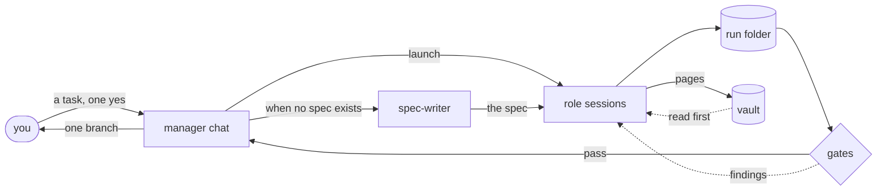
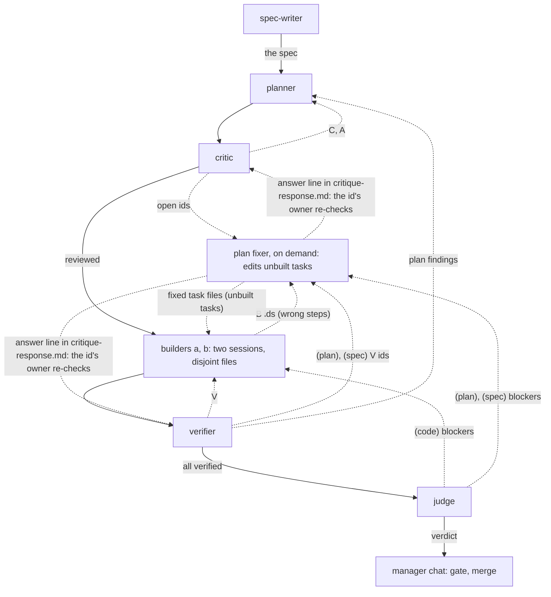
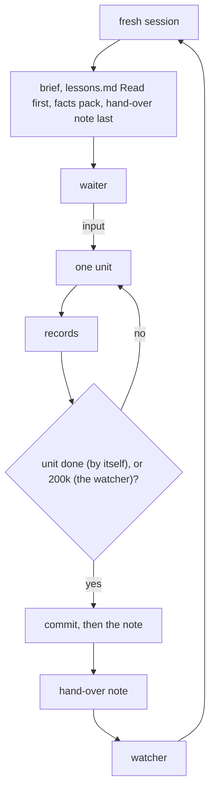

# The diagrams as text

The README shows these four flows as pictures drawn by the archify skill from the specs in this folder
(`<name>.<type>.json`); here they stay text you can edit
([decision](../../../wiki/decisions/diagrams-are-mermaid-text.md)).

## The run loop



## The roles and their records



## The knowledge layer

```mermaid
flowchart TD
  lessons["lessons.md"] -->|decisions| wiki["wiki/: index, decision pages"]
  context["context/: raw sources"] -->|compiled| wiki
  wiki -->|ingest| hot["ledgers, hot.md"] -->|at start| session["every session: hot.md, index, graph, files"]
  wiki -->|each commit| graph["code graph: graphify, wiki/graph/"] -->|ask first| session
  wiki -->|every project| vault["your vault, read on need"]
  records["a run's records: logs, transcripts"] -->|measurements| vault
  vault -->|your yes| gate{"contribute.py"}
  gate -->|passes| commons["public commons, not built yet"]
  commons -.->|a source| session
```

## A session's life


