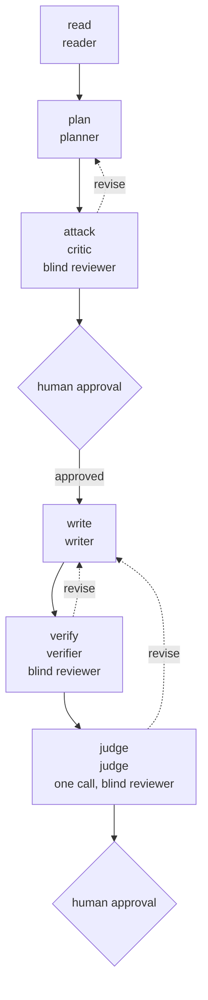

# Stage map: default

Generated by `harness map` from `docs/roles/stages.yaml`; edit the table, not this page. A box is a stage: its id, its role type and its tags (per task, one call, blind reviewer). A diamond is a human approval; the stages after it start once it is given. A dashed arrow is a reviewer's verdict `revise` returning the work. A double box is where a route label leads: the pipeline of that name, or `escalate`, which asks the human.

