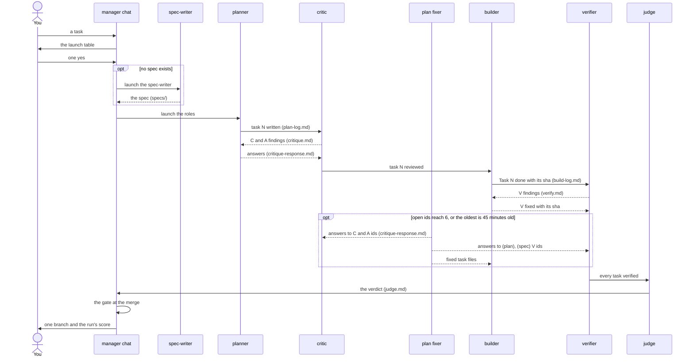

# How it works, step by step

This page follows one run of the pipeline skill (`.claude/skills/running-specagent-pipelines/`, below "the skill") from
your request to the merge and names the file each step writes. The README's [How it works](../README.md#how-it-works) is
the short form; [ARCHITECTURE.md](../ARCHITECTURE.md) gives the layers and the harness CLI's own stage pipelines.
`<run>` is the run folder, outside the repository, its record files are in [the files of a run](files-of-a-run.md);
every step below is taken from the skill's [SKILL.md](../.claude/skills/running-specagent-pipelines/SKILL.md)
("Pipeline", "Briefs") and its [example run](../.claude/skills/running-specagent-pipelines/example/README.md), unless a
link says otherwise.

## One run, start to end

Each step in order: who acts, what it writes, what closes it; the sections below give the detail.

| Step | Who | Writes | Closed by |
| --- | --- | --- | --- |
| 1. Your task; the run folder | the manager chat | the briefs; the facts pack `_inputs/<topic>.md` | the launch table |
| 2. The launch | the manager chat, you | `_launch.md`, `_control/usage.json` | your one `Yes:` line |
| 3. The spec, only when none exists | the spec-writer | a spec in `specs/` | a human's approval |
| 4. Each task and its review | the planner, the critic | task files, `plan-log.md`; C, A ids in `critique.md` | the planner's answers, re-checked by the critic |
| 5. Open ids, on demand | the plan fixer | `critique-response.md`, unbuilt task files | the role that raised the id: `<id>: fixed` or `closed` |
| 6. Tests first, one commit per task | a builder | `Task N: done — <sha>` in `build-log.md`; B ids | the verifier's check |
| 7. The check of each commit | the verifier, in its own worktree | V ids in `verify.md`: `(code)` to the builder, the rest to the planner or the plan fixer | its re-check; after three rounds, the rule |
| 8. Hand-overs, along the way | each role, the watcher | `handoff-<role>.md`, `_watch.log` | a fresh session, which reads the note |
| 9. Requests, along the way | a role, the manager | a `SANDBOX:` or `*-REQUEST:` line in its record | the manager's answer below it |
| 10. The verdict, once | the judge | `judge.md` | the manager chat: a blocker with proof goes back to the builders or the plan fixer, its fix (`J<n>: fixed — <sha>`) re-checked by the verifier before the gate; the rest stays for you |
| 11. The gate | the manager chat | the merge into `main` and the push | a green gate (a red one is a finding for the builder) |
| 12. The numbers | the manager chat | one score; your vault's measurement page | `collect_run.py`, once the record is saved |

## 1. You ask; the manager chat writes the run folder

The manager chat is the skill's main session
([decision](../wiki/decisions/the-manager-is-the-pipeline-skill-main-session.md)); it runs without the sandbox, held by
four guards ([decision](../wiki/decisions/the-manager-runs-without-the-sandbox.md)). It makes `<run>` and copies the
skill's example briefs into it with a leading `_`: `_common.md` (the brief every role reads first), one
`_<role>-assignment.md` per role, `_first-pass-rules.md`, `_handoff-rule.md`, `_launch.md`. `lessons.md` keeps its name,
because the roles add to it. The waiters (`wait_for_*.py`) are copied beside them, and each role's settings go to
`<run>/_control/` (`_agents.json`, `<role>-settings.json`), which every role's settings deny. A project's names go into
these copies, never into the skill
([decision](../wiki/decisions/pipelines-run-as-specagent-sessions-from-a-template-skill.md)). It also writes the
facts pack `<run>/_inputs/<topic>.md` that the briefs name, each tool fact with its source line: a session opens a
tool's documents only for a fact the pack lacks (R4 of [spec 003](../specs/003-pipeline-economy/spec.md)).

## 2. The launch table and your one yes

`_launch.md` holds one row per role: its settings and its cost estimate. Its `Estimate:` line prices a session and a
unit from your vault's measurement page of the last run of the same shape; the pre-flight fails one that names no
such page (R5). The manager runs the pre-flight
(`scripts/manager/preflight.py check <run> --checkout <checkout>`), sends you the table in one message, appends your
answer as a `Yes:` line and runs the pre-flight again with `--yes`
([decision](../wiki/decisions/the-launch-table-and-one-yes.md)). That yes covers every session of the run and the judge;
nothing after it waits for you. Writes: `<run>/_launch.md`, `<run>/_control/usage.json`.

## 3. The role sessions start, and the watcher keeps them going

The manager launches each role as a background Claude Code session (`claude --agent <type> --bg`) with its own
`--settings`, worktree and sandbox (section 8). In the background it starts the watcher, `scripts/watch_agents.py
<run>/_control/_agents.json`, which logs to `<run>/_watch.log`, and the record monitor, `scripts/monitor_records.py
watch <run>`, which reports a request line (section 8) still unanswered after 15 minutes and answers none itself
([decision](../wiki/decisions/monitor-answers-no-request.md)).

**When the watcher stops.** It cancels a permission prompt nobody answers after `permission_wait` (600 s) and
resumes a stopped session with a nudge, at most 6 times per agent. It returns to the manager, which decides and
restarts it: exit 0 on an event (an agent failed or is blocked, `blocked` on line 1 of a watched file, every STATUS
final, an order unacknowledged after its resends, or two live copies of one agent: `copies <agent>: <ids>`, nothing
else done for it that round; the manager decides which copy stays), 3 when a session passes its budget (150 calls or
2,000,000 output tokens; the session is not stopped), 4 when a settings file or the extra prompt file changed or a
brief was removed ([exits](../.claude/skills/running-specagent-pipelines/scripts/docs/watch_agents.md)).

When no spec exists, the manager launches the [spec-writer](../.claude/agents/spec-writer.md) first, on the model the
owner ordered for spec writing ([decision](../wiki/decisions/the-spec-writers-model-is-a-dated-exception.md)): it turns
the approved story into a one-page spec in `specs/`, each acceptance criterion mapped to a requirement: the skeleton,
for the planner to put the flesh on.

## 4. The planner writes a task; the critic attacks it

The planner writes each task of the plan (`docs/exec-plans/active/<plan>/`, checked by plan-lint): the files, the
signatures, the tests in full, the commands with `Expected:` lines and the spec coverage, not the implementation. It
logs the task in `plan-log.md`; with planner lanes, a `Task N: started by <role>` line there is the lock. The critic,
woken by `wait_for_task.py`, makes one coverage round per task, reads no code and files its findings in `critique.md`
under `#### C<n>` and its attack tests under `#### A<n>`, then messages the planner. The planner fixes the task at once
and answers each id below the finding in `critique-response.md`. When open ids reach 6, or the oldest is 45 minutes old
(the defaults), the watcher launches a plan fixer that answers them and edits unbuilt tasks; it stops the fixer when
none is open ([decision](../wiki/decisions/planner-answers-its-findings-fixer-on-demand.md)).

## 5. A builder builds the task

A builder's waiter (`wait_for_ready.py`) wakes it when its task's coverage round is answered: nothing starts on
speculation. The builder writes the failing test first, then the code, runs the package's suite and commits one task,
then logs `Task N: done — <sha>` with the counts (`N passed, M failed`) in `build-log.md`; with two builders on
disjoint files, `build-log-a.md` and `build-log-b.md`, and the manager writes `Merged: a→b at <sha>` in `lessons.md`
before a task that needs the other builder's code. A wrong plan step goes back as `B<n>: sent to plan-fixer`.

## 6. The verifier checks the commit

The verifier's waiter (`wait_for_log.py`) wakes it on the new log line. In its own clean worktree it checks out the
commit, reads the diff file by file against the task and the spec, re-runs the task's checks and files each finding in
`verify.md` as `#### V<n>`, tagged `(code)`, `(plan)` or `(spec)`, with a repro and a `Checklist: <file>:<line>` line
naming the checklist item it comes from (the skill's `example/common.md`, "Proof rule"). The builder fixes a `V<n>` at
once with one commit and logs `V<n>: fixed — <sha>`; `(plan)` and `(spec)` findings go to the planner as well, which
fixes that task and every later one. Every plan-caused finding, whoever files it (the critic's C and A, a builder's
`B<n>`, a `(plan)` or `(spec)` V), reaches the planner or the plan fixer, so the mistake does not return; the role
that raised the id re-checks and closes it (`<id>: fixed` or `closed`). After three rounds on one finding a rule
decides: the spec and recorded decisions win, else the safer option. When two findings share a cause, the cause
becomes a line under "Lessons from this run" in `lessons.md` for every later task.

## 7. A session hands over

A session does one unit (a task written, reviewed, built or verified) and then hands over, or earlier when its context
passes the cap of 200k tokens per call: it writes `handoff-<role>.md`, at most 40 lines of facts, whose line 1
`HANDOFF <role> after Task <N> — <time>` is the signal. The watcher stops it and starts a fresh session with the same
name, which reads its brief, the facts pack it names (R4), the hand-over rule, the "Read first" section of
`lessons.md` and, last, the note ([hand-over rule](../.claude/skills/running-specagent-pipelines/example/handoff-rule.md)). In a repeat
of like items (pages to ingest), a unit is sized from the last measured run to end under `handoff_at` (150k), past
which the watcher orders the hand-over at the unit's end; a session the order reaches inside a unit writes
`Unit size: <k> -> <k-1>`, and later units take the smaller size (R2). The cost side of this step is on
[Time and money](economy.md).

## 8. What each role session may touch

Each role session's sandbox, its two guards, what is denied to it and the request lines it writes when a step is
refused are on [their own page](what-a-role-may-touch.md).

## 9. The judge, the gate and the merge

Once every task is verified, a script launches the judge once: its verdict is line 2 of `judge.md`, a blocker goes back
like any finding, and a major or a minor stays there for you. The judge does not run again: a blocker's fix is one
commit logged `J<n>: fixed — <sha>`, the verifier re-checks it like a V fix, and the gate waits for that line. Then
the main session merges at the gate and pushes, scores the run and writes its measurement page in your vault; the
run's decisions are ingested, and `collect_run.py` removes the run's worktrees on your yes. Each step with its command
and its file: [the end of a run](the-end-of-a-run.md).
